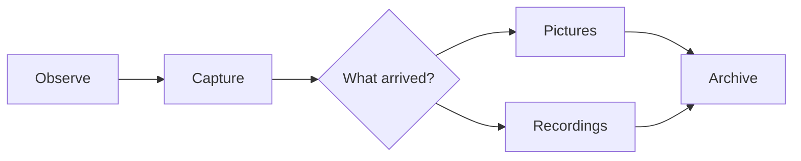

# Night Shift

*A small observatory. A long night. Everything in one folder.*

Welcome to peep's demo collection. Start the music, then keep exploring.
Images, animation, audio, diagrams, and documents all belong here.


## Tonight's collection

| Folder | What to open | What to try |
| --- | --- | --- |
| 01-images | Moonrise and Daybreak | Compare native previews; `f` fills the screen |
| 02-motion | The night pass | Play the video or GIF; pause and seek |
| 03-music | Night Shift | Play, then `v` for the audio-reactive spectrum |
| 04-audiobook | Two narrated chapters | Seek, change speed with `z` / `x`, reset with `c` |
| 05-diagrams | Signal path and shift handoff | Render Mermaid; `R` reveals the source |
| 06-code | Go, JSON, and YAML | Syntax highlighting and in-file search |

## The signal path

A good night starts with a simple routine: observe, capture, and keep the result.



## Field notes

- [x] Check the antenna before sunset.
- [x] Keep the first recording, even if it sounds ordinary.
- [ ] Leave a note for the next shift.

> Keep listening after the silence.

Press `Enter` or `f` to focus this document. Search for **signal** with `/`,
then use `n` / `N` to move between matches. `Esc` returns to the browser.
The signal appears in the diagram, in these notes, and in the story's second chapter.

```go
func keep(signal Recording) bool {
    return signal.Duration > 0 && signal.Checksum != ""
}
```

## By morning

The same ridge, a different light. This image uses a Markdown reference rather
than an inline destination; both forms render in peep.

![Daybreak over the ridge][morning]

[morning]: 01-images/02-daybreak.png

## Make it your own

Use `S` to sort. In **02-motion**, filter with `rec-*`; in **06-code**, try
`*.go`. `H` reveals hidden files. Cyan `LINK` entries are symbolic links.

`just demo` opens a disposable copy, so rename, move, and delete are safe to
show there. The committed collection stays ready for the next take.
